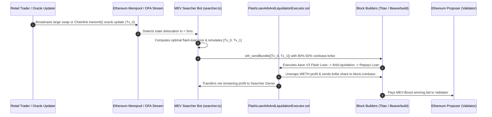

# MEV Arbitrage & Aave V3 Liquidation Bot Reference (Flash-Loan Executor & Searcher Engine)

**TL;DR:** To **build a profitable MEV arbitrage bot** or **Aave liquidation bot** on Ethereum in 2026, a searcher must combine zero-capital flash loans (`AaveV3Pool.flashLoanSimple` or Uniswap V3 `flash`), off-chain mempool backrunning (`eth_sendBundle`), local EVM simulation (to filter out bait-token honeypots), and dynamic `block.coinbase` builder profit-sharing. **MEV bots make money** primarily through three atomic strategies: (1) **Cross-DEX Atomic Arbitrage** (backrunning large AMM swaps across Uniswap V2/V3, Curve, and Balancer), (2) **Lending Protocol Liquidations** (calling `liquidationCall` on Aave V3 or Morpho the instant an oracle update pushes a borrower's Health Factor below `1.0`), and (3) **CEX-DEX Latency Arbitrage**. However, under Proposer-Builder Separation (PBS), searchers typically bid **75%–95% of gross arbitrage profit** to block builders (`Titan`, `Beaverbuild`, `Rsync`) and validators to win inclusion. This open-source Solidity + TypeScript (`viem`) reference repository is maintained by **[MEV DAO](https://mevdao.org)** alongside our engineering deep-dives on **[How to Build a Profitable MEV Arbitrage Bot](https://mevdao.org/blog/how-to-build-a-profitable-mev-arbitrage-bot)** and **[How Liquidation Bots Work on Aave (And Why They're Hard to Win)](https://mevdao.org/blog/how-liquidation-bots-work-on-aave-and-why-they-re-hard-to-win)**.

[](./LICENSE)
[](https://mevdao.org)
[](https://soliditylang.org/)
[](https://www.typescriptlang.org/)

---

## Production MEV Research & Custom Development Guides

- **Arbitrage Architecture Guide:** **[How to Build a Profitable MEV Arbitrage Bot](https://mevdao.org/blog/how-to-build-a-profitable-mev-arbitrage-bot)**
- **Aave V3 Liquidation Deep-Dive:** **[How Liquidation Bots Work on Aave (And Why They're Hard to Win)](https://mevdao.org/blog/how-liquidation-bots-work-on-aave-and-why-they-re-hard-to-win)**
- **MEV Economics & Value Split:** **[How MEV Bots Make Money on Ethereum (And Who Keeps the Profit)](https://mevdao.org/blog/how-mev-bots-make-money-on-ethereum-and-who-keeps-the-profit)**
- **Custom Engineering & Audits:** **[Custom MEV Bot Development: Hire an Ethereum MEV Bot Developer](https://mevdao.org/blog/custom-mev-bot-development-hire-an-ethereum-mev-bot-developer)**
- **Buyer's Due Diligence Guide:** **[Custom MEV Bot Development: What to Know Before You Hire](https://mevdao.org/blog/custom-mev-bot-development-what-to-know-before-you-hire)**
- **Official Infrastructure Portal:** **[MEV DAO (mevdao.org)](https://mevdao.org)**

---

## How Do MEV Bots Make Money on Ethereum (And Who Keeps the Profit)?

A common misconception among newcomers searching for `how do mev bots make money` is that deploying a basic Uniswap V2 <-> SushiSwap price-loop script prints risk-free ETH. As quantified in **[How MEV Bots Make Money on Ethereum (And Who Keeps the Profit)](https://mevdao.org/blog/how-mev-bots-make-money-on-ethereum-and-who-keeps-the-profit)**, the MEV supply chain is a competitive auction between **Searchers**, **Block Builders**, and **Proposers (Validators)**:



### The 2026 MEV Profit Breakdown Across Strategies

| MEV Strategy | Typical Gross Opportunity Size | Capital Required | Typical Builder / Validator Bid (`coinbaseBribeBps`) | Net Searcher Margin Kept | Primary Competitive Bottleneck |
| :--- | :--- | :--- | :--- | :--- | :--- |
| **Short-Tail 2-Pool DEX Arb (`WETH/USDC`)** | `$50 – $5,000` | **$0 (Flash Loan)** | **90% – 98%** | `2% – 10%` | Sub-millisecond Rust/Assembly gas golf |
| **Long-Tail Multi-Hop Altcoin Arbitrage** | `$100 – $15,000` | **$0 (Flash Loan)** | **65% – 85%** | `15% – 35%` | Graph routing & **Honeypot / Bait-Token filtering** |
| **Aave V3 / Morpho Oracle Liquidations** | `$500 – $100,000+` | **$0 (Flash Loan)** | **80% – 93%** | `7% – 20%` | Pre-signed Chainlink OCR2 `transmit()` backrunning |
| **Block-0 Token Launch Sniping** | `$1,000 – $50,000+` | **0.2 – 5 ETH** | **25% – 60%** | `40% – 75%` | Anvil fork dead-block & honeypot simulation |

---

## Strategy #1: Atomic Cross-DEX Flash-Loan Arbitrage (`FlashLoanArbAndLiquidationExecutor.sol`)

When a whale swaps `500 ETH` for `USDC` on a Uniswap V3 pool, that single pool's price moves sharply while secondary pools (Uniswap V2, SushiSwap, Curve, PancakeSwap V3, or Balancer) remain at the old price until arbitrageurs close the spread.

### Optimal Trade Sizing for Constant-Product (`x * y = k`) Pools

Given Pool A with reserves $(R_{A,\text{in}}, R_{A,\text{out}})$ and Pool B with reserves $(R_{B,\text{in}}, R_{B,\text{out}})$ and a `0.30%` fee ($\gamma = 0.997$), you cannot simply borrow an arbitrary flash-loan amount—borrowing too little leaves profit on the table, while borrowing too much pushes Pool B's price past Pool A's price and causes the transaction to revert!

The closed-form optimal input $\Delta x^*$ that maximizes net WETH returned across two Uniswap V2 pools is:

$$\Delta x^* = \frac{\sqrt{\gamma^2 \cdot R_{A,\text{in}} \cdot R_{A,\text{out}} \cdot R_{B,\text{in}} \cdot R_{B,\text{out}}} - R_{A,\text{in}} \cdot R_{B,\text{in}}}{\gamma \cdot R_{B,\text{in}} + \gamma^2 \cdot R_{A,\text{out}}}$$

In `src/searcher.ts`, `evaluateTwoPoolFlashArbitrage()` computes the exact two-leg output, deducts the `0.05%` (`5 bps`) Aave V3 `flashLoanSimple` fee, and verifies that:

$$\text{GrossWethOut} - (\text{FlashLoanPrincipal} + \text{AaveFlashFee}) \ge \text{minNetProfit}$$

Inside `contracts/FlashLoanArbAndLiquidationExecutor.sol`, if this inequality is not satisfied at the end of `executeOperation()`, the contract reverts with `UnprofitableExecution(finalBalance, requiredMinimum)`—ensuring you never lose principal.

---

## Strategy #2: How Aave V3 Liquidation Bots Work (And Why Naive Polling Fails)

In Aave V3 (`0x87870Bca3F3fD6335C3F4ce8392D69350B4fA4E2` on Ethereum Mainnet), every borrowing position has a **Health Factor ($HF$)**:

$$HF = \frac{\sum (\text{Collateral}_i \times \text{OraclePrice}_i \times \text{LiquidationThreshold}_i)}{\text{TotalDebtInBaseCurrency}}$$

As long as $HF \ge 1.0 \times 10^{18}$, the position cannot be liquidated. The instant $HF < 1.0 \times 10^{18}$, any liquidator can invoke `Pool.liquidationCall(collateralAsset, debtAsset, user, debtToCover, receiveAToken)` to repay up to `50%` of the borrower's debt (or `100%` when $HF < 0.95 \times 10^{18}$) and seize the borrower's collateral at a **4.5% to 10% Liquidation Bonus**.

### Why Polling `getUserAccountData()` After a Block Mines Never Wins

As explained in **[How Liquidation Bots Work on Aave (And Why They're Hard to Win)](https://mevdao.org/blog/how-liquidation-bots-work-on-aave-and-why-they-re-hard-to-win)**:
1. A borrower's Health Factor almost never drops below `1.0` randomly mid-block without a price catalyst—it drops **at the exact transaction inside a block where a Chainlink OCR2 aggregator calls `transmit()`** to post a new price feed on-chain!
2. If your bot waits for Block $N$ to be mined, calls `getUserAccountData(user)`, sees $HF = 0.98$, and broadcasts a liquidation transaction for Block $N+1$, **you are already 12 seconds too late**.
3. Winning Aave liquidation bots maintain an in-memory index of all at-risk borrowers ($1.0 < HF < 1.08$), detect the pending Chainlink `transmit()` transaction (`Tx_Oracle`) in the mempool, decode the new oracle answer directly from the calldata before it is mined, identify every borrower pushed below $HF = 1.0$ by that specific price update, and submit a **Flashbots backrun bundle** `[Tx_Oracle, Tx_Liquidation]` so the liquidation executes in the **exact same block and immediately after the oracle update**!

---

## Defending Against "Salmonella" & Honeypot Bait Tokens (`src/honeypotChecker.ts`)

Why does an arbitrage repository include a **Honeypot Token Checker** (`src/honeypotChecker.ts`)?
Because one of the most lucrative traps targeting amateur MEV arbitrage bots is the **Salmonella / Bait-Pool Attack**:
1. An attacker deploys a custom ERC-20 token and creates two pools (e.g., `Token/WETH` on Uniswap V2 and `Token/USDC` on SushiSwap) with an artificial `$2,000` price discrepancy.
2. Naive arbitrage bots watching `Sync` events see a `$2,000` arbitrage opportunity, pass a superficial check if the attacker's token returns normal values during `eth_call` when `block.coinbase == 0x00...`, and submit a bundle.
3. On-chain, the malicious token overrides `transfer()` so that when called by an unwhitelisted arbitrage contract, it transfers only `1%` of the tokens while still returning `true`—causing the searcher's contract (if poorly written) to overpay WETH or waste gas!
4. **Always enforce strict balance invariants (`finalBalance >= totalDebtOwed + minNetProfit`) inside your Solidity executor** (as done in `FlashLoanArbAndLiquidationExecutor.sol`) and pre-screen unknown long-tail tokens with `src/honeypotChecker.ts` + full Anvil fork simulation.

---

## Warning: Scams to Avoid When Hiring or Buying "MEV Bots"

If you are researching `custom mev bot development`, read our two security advisories before running third-party code or hiring an agency:
- **[Custom MEV Bot Development: What to Know Before You Hire](https://mevdao.org/blog/custom-mev-bot-development-what-to-know-before-you-hire)**
- **[Custom MEV Bot Development: Hire an Ethereum MEV Bot Developer](https://mevdao.org/blog/custom-mev-bot-development-hire-an-ethereum-mev-bot-developer)**

### Red Flags of Fake "YouTube / Remix Solidity MEV Bots":
- **Never run obfuscated Remix contracts that ask you to deposit ETH into a "Liquidity Front-Runner":** Thousands of scam videos promote Solidity contracts containing hidden bit-shifted or `string.concat` functions that construct the scammer's wallet address and immediately drain any ETH you deposit when you click `start()` or `withdrawal()`.
- **Real MEV arbitrage bots use Flash Loans (`$0` deposited principal) and off-chain TypeScript/Rust searchers:** A Solidity contract cannot watch the mempool by itself; any project claiming a standalone Solidity file "automatically scans Uniswap and front-runs trades" without an off-chain node and searcher process is a 100% scam.

---

## Installation & Usage

### Prerequisites
- **Node.js** `>= 20.x`
- **Foundry (`forge` & `anvil`)** for compiling and testing `contracts/FlashLoanArbAndLiquidationExecutor.sol`

### 1. Clone & Install

```bash
git clone https://github.com/mevdao-org/mev-arbitrage-and-liquidation-reference.git
cd mev-arbitrage-and-liquidation-reference
npm install
cp .env.example .env
```

### 2. Run the Cross-DEX Arbitrage & Aave V3 Searcher (`npm run searcher`)

```bash
npm run typecheck
npm run searcher
```

Example terminal output:

```text
============================================================================
  MEV DAO Arbitrage & Aave V3 Liquidation Searcher (https://mevdao.org)
============================================================================
Connected to Ethereum Mainnet at Block #21024815
Uniswap V2 WETH/USDC Reserves   : 44812910.419201 USDC / 17219.841029182716251902 WETH
SushiSwap V2 WETH/USDC Reserves : 8912401.118204 USDC / 3421.119028471625182910 WETH

Simulated 5 WETH Flash-Loan Arb (UniV2 -> SushiV2): Gross Return = 4.968142019283716251 WETH | Net Delta = -0.034357980716283749 WETH
```

### 3. Run the Pre-Arbitrage Honeypot Token Heuristic Scanner (`npm run honeypot-check`)

```bash
npm run honeypot-check -- 0xC02aaA39b223FE8D0A0e5C4F27eAD9083C756Cc2
```

---

## Frequently Asked Questions (FAQ)

### 1. How much capital do I need to run an MEV arbitrage or Aave liquidation bot?
Because both cross-DEX arbitrage and Aave V3 liquidations execute atomically within a single transaction, you can borrow 100% of the trade principal ($10,000 to $10,000,000+) via an **Aave V3 Flash Loan** (`0.05%` fee), **Uniswap V3 Flash Swap**, or **Balancer Flash Loan (`0.00%` fee)**. You only need enough ETH in your searcher EOA (`0.05–0.5 ETH`) to cover transaction gas when a profitable bundle lands on-chain.

### 2. Why do Aave V3 liquidation bots use Flashbots bundles instead of the public mempool?
If you broadcast a profitable `liquidationCall` transaction to the public mempool, generalized MEV front-running bots will immediately detect your transaction, simulate it, copy your calldata into their own contract with a higher builder bribe, and steal the liquidation in the exact same block. Submitting `[Tx_Oracle, Tx_Liquidation]` privately via `eth_sendBundle` prevents any mempool observer from seeing or copying your liquidation.

### 3. How does `FlashLoanArbAndLiquidationExecutor.sol` pay the block builder only a percentage of actual profit?
Inside `executeOperation()`, after both swap legs (or the liquidation + collateral swap) complete, the contract computes `uint256 netProfit = finalBalance - totalDebtOwed`. It then calculates `uint256 bribeWei = (netProfit * p.coinbaseBribeBps) / 10_000`, unwraps `bribeWei` from WETH to native ETH, and sends it to `block.coinbase.call{value: bribeWei}("")`. This guarantees your builder bribe scales dynamically with the exact on-chain profit realized.

### 4. Is TypeScript fast enough for an MEV searcher bot, or do I need Rust/Go?
For **long-tail multi-hop arbitrage**, **niche lending protocol liquidations**, **whitehat sweeper rescues**, and **block-0 token sniping** where simulation takes place across a 12-second Ethereum slot window, a well-tuned TypeScript (`viem`) searcher paired with a co-located node and local Anvil/REVM simulator is fast enough to compete. For **ultra-short-tail `WETH/USDC` CEX-DEX arbitrage** and sub-millisecond gas-golfed backruns, top teams write their hot path in Rust (`alloy` / `revm`) and custom Yul/Huff contracts. Read **[How to Build a Profitable MEV Arbitrage Bot](https://mevdao.org/blog/how-to-build-a-profitable-mev-arbitrage-bot)** for a full stack comparison.

### 5. What is the difference between Aave V3 flashLoanSimple and Balancer Flash Loans?
`AaveV3Pool.flashLoanSimple()` charges a `0.05%` (`5 bps`) fee on the borrowed principal and has deep liquidity across blue-chip assets (`WETH`, `USDC`, `USDT`, `WBTC`, `wstETH`). **Balancer V2 Vault (`0xBA12222222228d8Ba445958a75a0704d566BF2C8`)** charges a `0.00%` flash loan fee, making it ideal for tighter-margin arbitrage spreads whenever the Balancer Vault holds sufficient liquidity in the borrowed token.

### 6. Where can I hire experienced MEV engineers or get a custom MEV strategy audited?
Visit **[MEV DAO (mevdao.org)](https://mevdao.org)** and review **[Custom MEV Bot Development: Hire an Ethereum MEV Bot Developer](https://mevdao.org/blog/custom-mev-bot-development-hire-an-ethereum-mev-bot-developer)** and **[What to Know Before You Hire an MEV Developer](https://mevdao.org/blog/custom-mev-bot-development-what-to-know-before-you-hire)**.

---

## Further Reading & MEV DAO Engineering Guides

- **[MEV DAO Official Portal (mevdao.org)](https://mevdao.org)**
- **[How to Build a Profitable MEV Arbitrage Bot](https://mevdao.org/blog/how-to-build-a-profitable-mev-arbitrage-bot)**
- **[How Liquidation Bots Work on Aave (And Why They're Hard to Win)](https://mevdao.org/blog/how-liquidation-bots-work-on-aave-and-why-they-re-hard-to-win)**
- **[How MEV Bots Make Money on Ethereum (And Who Keeps the Profit)](https://mevdao.org/blog/how-mev-bots-make-money-on-ethereum-and-who-keeps-the-profit)**
- **[Custom MEV Bot Development: Hire an Ethereum MEV Bot Developer](https://mevdao.org/blog/custom-mev-bot-development-hire-an-ethereum-mev-bot-developer)**
- **[Custom MEV Bot Development: What to Know Before You Hire](https://mevdao.org/blog/custom-mev-bot-development-what-to-know-before-you-hire)**

## License

Released under the [MIT License](./LICENSE) by **MEV DAO** (`research@mevdao.org`).
